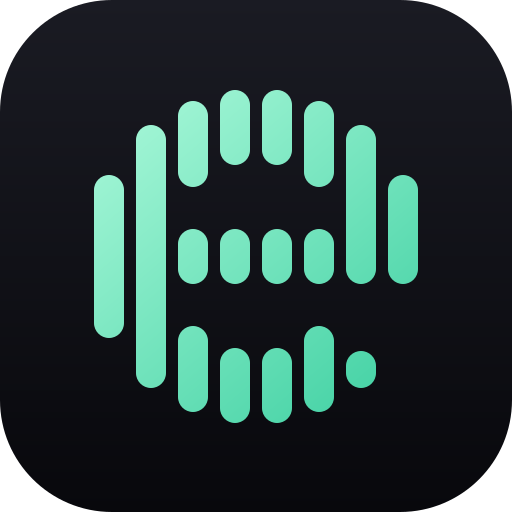
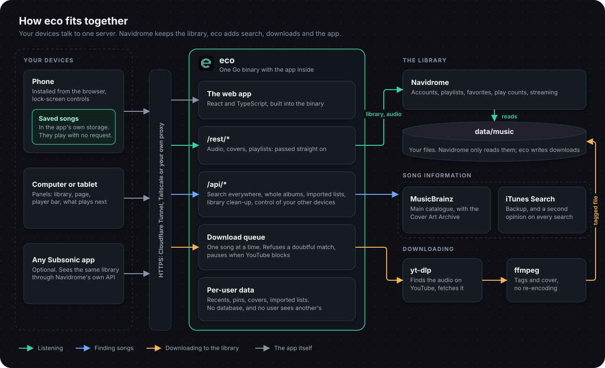

<p align="center">
  
</p>

<h1 align="center">Eco</h1>

<p align="center">
  <strong>Your own music app.</strong><br>
  Listen to your library, search for any song and download what you do not have yet, on a server you control.
</p>

<p align="center">
  <a href="https://github.com/Thrashy190/eco/releases"></a>
  <a href="https://github.com/Thrashy190/eco/actions/workflows/ci.yml"></a>
  <a href="LICENSE"></a>
</p>

<p align="center">
  
  
  
  
  
  <br>
  
  
  
  
  
</p>

<p align="center">
  <a href="#quick-start">Quick start</a> ·
  <a href="#adding-music">Adding music</a> ·
  <a href="docs/configuration.md">Configuration</a> ·
  <a href="docs/architecture.md">Architecture</a> ·
  <a href="CONTRIBUTING.md">Contributing</a>
</p>

> **Status:** early and actively developed. The interface is English only for now.

## What it does

**Listen**

- A fast web app you can install on your phone, with a queue, lock-screen controls and playlists.
- On a computer or a tablet the whole page takes the colour of the music, with a deck beside it for the song and what plays next.
- Play on any of your devices from any other: pause, skip, change the volume or move the music across. Only your own devices.
- Paste a YouTube link to keep its audio as a podcast or an audiobook. Those remember where you stopped and play at your speed.

**Find and download**

- One search box finds songs in your library and songs and albums you do not own, from [MusicBrainz](https://musicbrainz.org) with iTunes as a backup. No account, key or subscription.
- Open an album to see every track in order and which ones you have, then tick the ones to download.
- Tapped songs are fetched, tagged with proper metadata and cover art, and appear in your library in seconds.
- Import a playlist exported from Spotify or anywhere else: it becomes a real playlist of what you have, and you can download the rest.

**Take it with you**

- Download your favorites, a playlist, an album or single songs. They play from the device, with no request to the server for the audio.
- A download does not fail because of a bad moment: failed songs are tried again, and what is left carries on by itself after the connection returns or the app reopens. [What phones allow in the background](#offline-on-a-phone) has limits.
- Downloaded collections stay in sync, and *Offline mode* in Settings uses only what is on the device.

**Make it yours**

- Themes, any accent colour, fonts and text size, what Home shows and in what order, which tabs you get, grid or list.
- Pin songs, albums, playlists and artists, and give playlists their own cover.
- Administrators can delete songs for everyone and review songs held twice and artists that are really several people.
- Your files, your server. [Navidrome](https://www.navidrome.org) is underneath, so any Subsonic app also works.

## How it fits together

<p align="center">
  
</p>

More in [docs/architecture.md](docs/architecture.md).

## Quick start

You need a machine that is always on (a PC, a Raspberry Pi 4 or newer, a home server, a VPS) with [Docker](https://docs.docker.com/engine/install/) and Docker Compose v2.

```bash
git clone https://github.com/Thrashy190/eco.git && cd eco
cp .env.example .env
mkdir -p data/music navidrome secrets       # folders the containers use
docker compose up -d --build
```

Then:

1. Open **http://localhost:4533** and create your first account. The first user is the administrator.
2. Open **http://localhost:8000**. That is Eco. Sign in with the account you just created.
3. Add some music (see [Adding music](#adding-music)) and search for it.

Searching beyond your library works right away. Downloading usually needs YouTube cookies, explained below; without them Eco is still a good player.

## Prerequisites

| You need | Why | Notes |
|---|---|---|
| **Docker and Compose v2** | runs everything | `docker compose version` should print v2.x |
| **YouTube cookies** | YouTube blocks anonymous downloads after a while | [setup](docs/configuration.md#youtube-cookies). Optional at first |
| About 1 GB of free RAM, disk for your music | | At rest, with over 1,000 songs: Navidrome about 150 MB, Eco about 10 MB. Downloads use more while they run |

Not using Docker? You need [Go 1.22+](https://go.dev/dl/), [Node.js 22.22+](https://nodejs.org) to build the web app, [ffmpeg](https://ffmpeg.org) and [yt-dlp](https://github.com/yt-dlp/yt-dlp), plus a running Navidrome. yt-dlp also needs a JavaScript runtime, and that Node.js counts. See [Running without Docker](#running-without-docker).

## Configuration

Every setting lives in `.env`, and [docs/configuration.md](docs/configuration.md) explains each one and where to get it. The one you will want first:

- **YouTube cookies** (`YT_COOKIES_BROWSER` or `secrets/cookies.txt`): [how to set them up](docs/configuration.md#youtube-cookies). YouTube blocks anonymous downloads after a while.

## Adding music

Use whichever fits you; they all end up in the same library.

| Way | Good for |
|---|---|
| **The search box in Eco** | Anything in [MusicBrainz](docs/configuration.md#where-song-information-comes-from): search, tap **Get**, or open an album and choose its tracks. |
| **Import a playlist**, in the app | A list exported to a file from Spotify or elsewhere: it becomes a playlist, and you can download what is missing. |
| **`eco likes`** | Download your whole Spotify *Liked Songs* or a playlist in bulk, through your own [Spotify developer app](docs/configuration.md#spotify). See [Command line](#command-line). |
| **Copy files** into `data/music/` | Music you already own. Navidrome scans every minute. |
| **`scripts/upload.sh`** | Your own recordings: converts, tags and uploads them. |
| **A YouTube link** (podcast, audiobook...) | Paste it in the search box. Only the audio is kept, apart from your music, in `data/media/`. |
| **Lidarr** (`--profile downloads`) | Whole albums through the \*arr stack. [Guide](docs/downloads-stack.md). |

Downloads land in `data/music/YouTube/Artist/Album/NN - Title.m4a`, tagged and with a cover.

## Podcasts and audiobooks

Paste a YouTube link into the search box (a single video, not a playlist). Eco shows what it is, you choose a category, and it downloads **only the audio** in the background:

| Category | Good for | Extras |
|---|---|---|
| **Podcast**, **Audiobook** | long listening | remembers where you stopped, speed button (0.75x to 2x), can be saved for offline |
| **Other** | talks, lectures, sounds | the same |

These files live in `data/media/<category>/<video id>/`, **not** in your music folder, so Navidrome never sees them or mixes them into your artists, albums or shuffled mixes. Eco stores and serves them itself. Only YouTube links are accepted.

## Use it from your phone

Open Eco in your phone's browser and use **Add to Home Screen** (iPhone: Share, then Add to Home Screen; Android: menu, then Install app). It then behaves like an app.

To reach your server from outside your home you need HTTPS. Options, easiest first, are described in [docs/deployment.md](docs/deployment.md): a **Cloudflare Tunnel** (`--profile tunnel`), **Tailscale**, or a reverse proxy of your own. Do not expose the port directly to the internet.

### Offline on a phone

Downloads are kept in the app's own private storage (the browser's IndexedDB). They do not appear in the Files app or the photo roll, Settings in Eco shows how much space they use, and removing the app from the home screen deletes them.

A web app cannot download freely in the background. An iPhone freezes it shortly after it leaves the screen, unless music is playing, so a long download there runs while the app is open: Eco keeps the screen on for it, and when you return it carries on from where it was. Nothing is lost when that happens. Whatever is already saved plays at once, even before the whole collection arrives.

## Command line

The `eco` binary is also a toolbox. With Docker: `docker compose run --rm eco <command>`; without: `./bin/eco <command>`.

```bash
eco doctor                          # check yt-dlp, ffmpeg, Navidrome, the catalogue, cookies
eco get "https://youtube.com/watch?v=..."     # one YouTube link becomes a tagged song
eco get -q "artist song" URL        # pick the match yourself (-y: take the first, -n: dry run)

# Your Spotify liked songs, step by step (each step can be interrupted and resumed)
eco likes export                    # signs in to Spotify the first time
eco likes search --first 200        # find the YouTube video of your 200 most recent likes
eco likes download                  # fetch every song marked "found"
eco likes favorites                 # mark them as favourites in Navidrome, in the order you liked them
eco likes all                       # every step above

# A Spotify playlist becomes a Navidrome playlist
eco likes all --playlist "My playlist"
eco likes playlist --playlist "My playlist"   # only write its .m3u again ("download" already does it)

eco version                         # which release this is
```

Your **liked songs become your Navidrome favourites**, which Eco shows as a *Favorites* playlist at the top of your library. In Navidrome they stay favourites; real playlists are for Spotify playlists you choose. `favorites` needs `ND_USER` and `ND_PASS` ([configuration](docs/configuration.md#nd_user-nd_pass)) and is safe to repeat: songs already favourited are skipped.

`eco likes` keeps its state in `data/likes.csv` (or `data/playlists/NAME.csv`). A song is `pending`, `found`, `review` (needs a human look), `downloaded` or `error`; edit the file freely. `--limit N` processes at most N songs (`0` means no limit).

`eco likes export` opens a browser for the Spotify login, so run it on a machine with a browser; the CSV files it produces can then be used anywhere.

## Running without Docker

```bash
make tools          # downloads yt-dlp into bin/ (Linux x86_64; elsewhere install it yourself)
make doctor         # tells you what is missing
make run            # http://127.0.0.1:8000
```

Eco reads `.env` from the current directory. Point it at your Navidrome with `ECO_NAVIDROME_URL` (default `http://127.0.0.1:4533`).

## Updating

```bash
git pull
make docker             # builds the image and records its release
docker compose up -d
```

`docker compose up -d --build` also works, but `eco version` and the logs then say `dev`.

Each feature and fix is a [release](https://github.com/Thrashy190/eco/releases) with its notes, numbered with [semantic versioning](https://semver.org): `v1.2.3` is a fix over `v1.2.2`, `v1.3.0` adds something, and `v2.0.0` asks you to change something when updating.

yt-dlp changes whenever YouTube does. If downloads start failing everywhere, rebuild without cache to get the latest: `docker compose build --no-cache eco && docker compose up -d`.

## Troubleshooting

| Symptom | Try |
|---|---|
| `eco doctor` reports something missing | Follow the hint it prints. |
| "Sign in to confirm you're not a bot" | [YouTube cookies](docs/configuration.md#youtube-cookies). |
| "no confident match on YouTube" | Eco refused a doubtful video (wrong length or title). Use `eco get -q ... URL` to pick one by hand. |
| Searching only shows your library | The server cannot reach musicbrainz.org, or it asked Eco to wait a moment; the search says which. |
| A song or album is not found | MusicBrainz is made by volunteers and may not have it yet. [Anyone can add it](https://musicbrainz.org/doc/How_to_Add_a_Release). |
| A new song does not show up | Navidrome scans every minute; give it a moment. |
| A download for offline says *Waiting* | No connection, or the server is not answering. It carries on by itself. |
| Wrong username or password | Use your **Navidrome** account: Eco has no accounts of its own. |

## Development

```bash
make check          # gofmt, go vet, go test, TypeScript, web tests and build: the same as CI
make run            # build and serve
make web-dev        # the web app with hot reload, using the eco running on :8000
```

The Go code lives in `cmd/` and `internal/`; the web app in `web/src/` is React and TypeScript, built with Vite and embedded into the binary. See [CONTRIBUTING.md](CONTRIBUTING.md). To report a security problem, see [SECURITY.md](SECURITY.md).

## Responsible use

Eco is a tool for managing and playing a personal music library. It downloads audio from YouTube using yt-dlp; doing so may violate YouTube's terms of service and, depending on where you live and what you download, copyright law. You are responsible for what you download and for having the right to do so. Do not use Eco to distribute copyrighted music. Buying music from the artists you love is always welcome.

## License

[MIT](LICENSE). Use it, change it, share it.
