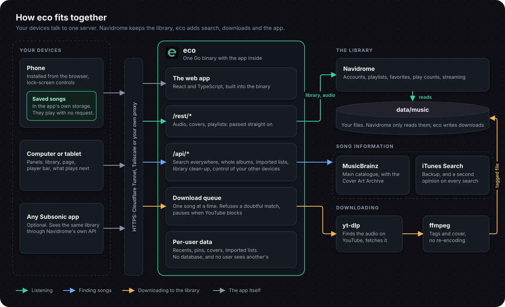

# Architecture

Eco has three moving parts. Navidrome is the music server; Eco sits in front of it; yt-dlp and ffmpeg do the downloading.



## Why these choices

| Decision | Reason |
|---|---|
| **Navidrome as the server** | Light (about 150 MB at rest with over 1,000 songs), speaks the Subsonic/OpenSubsonic API, has users, playlists, favourites and play counts. Eco does not reimplement any of it. |
| **Eco proxies `/rest/*` untouched** | The web app gets a single origin (no CORS) and any Subsonic client keeps working when pointed at Eco. |
| **No database in Eco** | Users and playlists live in Navidrome. Download history is a CSV; job state is in memory; recents, pins, playlist covers and imported lists are one folder per user. Fewer things to back up. |
| **Authentication reuses Navidrome's** | Each request carries Subsonic credentials (`u`, `t = md5(password+salt)`, `s`); Eco checks them with Navidrome's `ping` and remembers the answer for five minutes. The password is never stored by the web app. |
| **yt-dlp and ffmpeg are executed, not embedded** | YouTube changes constantly; yt-dlp must be updatable without rebuilding Eco. Tags are written by remuxing with ffmpeg (no re-encoding). |
| **Go, one binary, web app embedded** | Easy to deploy and cross-compile; the web app (React and TypeScript, built with Vite) is compiled into the binary, so running Eco needs neither Node nor separate files. |
| **Navidrome mounts the music read-only** | Only Eco changes files: downloads go to `YouTube/`, and an administrator can delete any song. |

## Library layout

```
data/music/
├── YouTube/<Album artist>/<Album>/NN - Title.m4a   downloads made by eco
├── Playlists/*.m3u                                  Navidrome imports these as playlists
├── Originals/                                       your own recordings (scripts/upload.sh)
└── Lidarr/                                          Lidarr's root folder (profile "downloads")

data/media/<kind>/<video id>/{media.m4a, media.jpg, meta.json}       imported audio: podcasts, audiobooks, other
data/users/<hash of username>/{state.json, imports.json, covers/<playlist id>.jpg}  recents, pins, imported lists and playlist covers
data/backup/artists-<date>/                                           the original files of a clean-up that rewrote artist tags
```

`data/media/` is deliberately **outside** `music/`: Navidrome would otherwise index podcasts and audiobooks as albums and artists and shuffle them into your music. Navidrome never sees these files; Eco serves them itself (with `Range` support, so seeking works).

`Originals/` and `Lidarr/` are kept apart on purpose: Lidarr matches against MusicBrainz and would flag your own music as unrecognised.

## A download, step by step

1. The web app calls `POST /api/download?id=…`. Eco queues a job and answers at once.
2. A worker (one at a time, to be kind to YouTube) reads the track from the catalogue: title, artists, album, cover, length.
3. **Choosing the video.** A plain YouTube search runs first (one cheap call that already returns length and channel). Only if that result is not clearly right does Eco also search YouTube Music, which is slower and rate-limited sooner. Each candidate is scored by how far its length is from the catalogue's, penalised for unwanted versions (live, remix, sped up…) unless the song itself is one, and rewarded for official channels. The title must also match: a different song of the same length is rejected.
4. A candidate is accepted automatically only if it is within 10 s and has nothing odd about its title; otherwise the job fails with the reason, so a wrong song never reaches your library.
5. yt-dlp downloads the audio (progress is reported), ffmpeg tags it and embeds the cover, and the file is moved into place.
6. Eco asks Navidrome to scan and looks for the new song, so the app can play it immediately. The job then becomes `ready` with the song's Navidrome ID.

The web app polls `/api/jobs` and draws a spinner, then a progress ring, then a check.

## HTTP API

Everything under `/api` needs the Subsonic credentials as query parameters (`u`, `t`, `s`).

| Endpoint | Returns |
|---|---|
| `GET /api/search?q=` | `songs`, `artists` and `albums` from your library. Never waits for the catalogue |
| `GET /api/search/external?q=` | what the catalogue adds: `external` (songs you do not own, plus the artist's other songs when the query is an artist), `external_albums`, `hide_albums` (library albums the catalogue also returned), and `warning` when it is slow or limiting Eco |
| `GET /api/catalog/albums/{id}` | a whole album from the catalogue, tracks in order; a track you have carries `library` with the song from your library |
| `GET /api/albums/match?name=&artist=` | the whole catalogue album matching a library album, tracks in order with what you have marked; `album` is null when there is none, and the answer is 503 when the catalogue could not say in time, so ask again |
| `GET /api/artists/lookup?name=` | the library artist with exactly this name; `id` is empty when there is none |
| `GET /api/me/library` | your `recents`, `pins` and `covers`; albums Navidrome saw played fill out the recents |
| `POST /api/me/recents`, `POST /api/me/pins` · `DELETE /api/me/{recents,pins}/{type}/{id}` | remember or forget an item (JSON body: `type`, `id`, `name`, how to draw it) |
| `GET`, `PUT`, `DELETE /api/covers/playlists/{id}` | the picture you chose for a playlist (or `favorites`). `PUT` takes a JPEG of at most 2 MB |
| `GET /api/discover?artist=` | songs by that artist that are not in your library |
| `GET /api/home` | newest, recently played and most played albums, random songs, recent downloads |
| `GET /api/songs?offset=&limit=&sort=` | the whole library, paged. `sort` is `added` (the default), `title`, `artist`, `album` or `length` |
| `POST /api/download?id=` | queue a download; repeated calls for the same song return the same job |
| `POST /api/imports/parse?name=` | read a file (the body) and say which lists it holds, saving nothing |
| `POST /api/imports` · `GET /api/imports`, `/api/imports/{id}` | make or update a playlist from a list (JSON: `name`, `rows`); list them; one, with each song and whether you have it |
| `POST /api/imports/{id}/sync`, `/download` · `DELETE /api/imports/{id}` | bring its playlist up to date; queue the songs you lack; forget it (the playlist stays) |
| `GET /api/admin/cleanup` | administrators: `duplicates`, combined `artists`, and the `task` running |
| `POST /api/admin/cleanup/duplicates`, `/artists` | administrators: delete other copies (JSON: `keep`, `remove`); separate artists (JSON: `names`, and optionally `parts`, where a name splits when a comma belongs to a name: `{"Tyler, The Creator, Kali Uchis": ["Tyler, The Creator", "Kali Uchis"]}`; the parts must give the name back joined with commas) |
| `GET /api/media/preview?url=` | what a YouTube link is (title, channel, length, thumbnail) and whether it is already imported |
| `POST /api/media/import?url=&kind=` | import the audio of a link as `podcast`, `audiobook` or `other`; the same video is never imported twice |
| `GET /api/media?kind=` | imported items, newest first |
| `GET /api/media/{id}/file`, `/thumb` | the media (with `Range`), its thumbnail |
| `GET /api/jobs` | your recent jobs (never other people's) with `state` (`queued`, `searching`, `downloading`, `tagging`, `ready`, `error`) and `progress` |
| `GET /api/artists/songs?name=` | every song in the library that names this artist, as the main artist or alongside others, in album order |
| `GET /api/me` | who you are, whether you are an administrator, and which `catalog` answers |
| `DELETE /api/admin/songs/{id}` · `DELETE /api/media/{id}` | **administrators only**: delete a song (its file and Navidrome's record of it; `428` until the password is confirmed) or an imported item, for everyone |
| `POST /api/admin/unlock` | administrators: confirm the password (JSON: `password`), which opens Navidrome's own API to Eco for 15 minutes, for accounts and deleting |
| `GET /api/connect/events?device=&name=&can_volume=` | a device's stream (Server-Sent Events): `devices`, `state`, `command` |
| `POST /api/connect/state?device=` · `POST /api/connect/command?device=` | report what this device plays; send a command to another device of your account |
| `/rest/*` | Navidrome's Subsonic API, passed through |
| `GET /healthz` | liveness |

## Imported media

`internal/media` keeps items on disk (one folder per video, with a `meta.json`), so there is still no database. Only the audio is downloaded, as M4A, with the video's thumbnail as its cover. Only `youtube.com`, `youtu.be` and their subdomains are accepted: letting a signed-in user make the server fetch arbitrary addresses would turn Eco into a probe of your home network. A failed import removes its half-written folder.

## Your library

The library opens on **Recent**: Favorites, then what you pinned, then what you opened or played lately. Favorites are stars in Navidrome, but the app presents them as a playlist with the reserved ID `favorites`. `internal/userdata` stores the recents and pins on the server, so every device shows the same list, with one JSON file per user and a copy in the browser for offline use. That copy is checked before it is used or saved (`isLibraryState`): an answer cut short reaches the app as `{}`, and once saved it would blank the app on every launch.

Playlist covers are stored the same way, because the Subsonic API has nowhere to put them: they appear in Eco only, for the user who chose them. The browser crops the picture to a 640×640 JPEG before uploading, and the server refuses anything that is not a real JPEG.

An album looks the same however you reach it. `/catalog-album/{id}` starts from the catalogue. `/album/{id}` shows the library at once and turns into the same page as soon as the catalogue finds the album, keeping any song it does not list under "Also in your library". Either way you see the whole album with what you have marked and can tick tracks to download. While the catalogue is being asked the page says so, and it asks again when the catalogue runs out of time: `/api/albums/match` answers 503 for "could not say in time", which is different from `album: null`, "no such album". Each answer is cached, so asking again gets further. With no match `/album/{id}` stays what the library holds and keeps playing.

## Lists from elsewhere

**Import a playlist** reads a file: a CSV from any tool or Spotify's account data, which needs no account here and no API. Each list becomes a real Navidrome playlist of the songs the library has, in the list's order. Songs it lacks are only fetched when asked; each joins the playlist as it arrives, and is looked up in the catalogue for its tags and cover. Importing a newer file with the same list name updates the same playlist, keeping songs added by hand. It cannot follow a Spotify playlist by itself: since February 2026 Spotify's API only lists a playlist's songs to its owner, logged in to a developer app owned by someone with Premium.

## Keeping the library tidy

Administrators get **Library clean-up** in Settings. Eco proposes and an administrator decides. *Copies* are songs with the same title, version and first artist within 3 s of each other; deleting one goes through the same identification as any deletion, and the person's favourite and playlists move to the copy that stays. *Artists*: Navidrome treats `Bad Bunny, Chuwi` as one artist, because a comma can be part of a name, but splits `Bad Bunny; Chuwi`. Eco rewrites those tags, keeping a copy of each file in `data/backup/` and only replacing a file once the audio of the new one is proven identical. New downloads are tagged that way from the start. Song IDs, favourites and playlists survive this (checked on a real Navidrome); an album whose album artist changes gets a new ID.

## The queue

The player's queue is one list in play order (`stores/player.ts`, rules in `lib/queue.ts`). Songs added with *Play next* or *Add to queue* are marked `queued` and wait right after the song playing, before the rest of the album or playlist: *Play next* goes first, *Add to queue* after the songs already waiting. The queue shows them under their own heading, apart from the list they interrupt. They survive starting another album, and jumping to a later song keeps them waiting after it. Every song that has not played can be dragged by its handle (pointer events, so touch and mouse alike) or moved with the arrow keys; a song dropped among the added ones becomes one of them, and one dropped among the album's songs becomes part of it, so the added songs always stay together at the front.

## Screens

Every screen shares one look: behind everything, a slow wash of the cover's colour, with floating glass bars over it. Below 760 px wide it is the phone app, with floating tabs and a mini player above them that opens the full-screen player. From there on the page scrolls by itself below one bar (back, the chosen places, search, your account), with a capsule floating at the bottom for what is playing, which opens the full-screen player. From 1100 px the capsule gives way to the deck, a column beside the page with the song, every control and what comes next, there only while something plays. Album, playlist and artist pages keep the picture and the buttons still in a column of their own once the page is wide enough, which depends on whether the deck is open, so those layouts use container queries rather than the width of the screen.

Styles are Tailwind utilities in the components, with the ones several screens share in `lib/ui.ts`. `styles.css` holds what utilities cannot express: the design tokens the themes change at run time, keyframes and the parts of a range input. `lib/media.ts` and the breakpoints in `styles.css` must agree on the widths.

## Who can see and change what

Songs, podcasts and audiobooks are one shared library. Everything personal stays with its account: recents, pins, playlist covers, the profile picture, the download queue (`jobs.List(user)`) and connected devices. Deleting from the shared library needs a Navidrome administrator, which the server asks Navidrome on every request rather than trusting the app or a remembered sign-in.

Deleting a song has to find its file, and Navidrome's `path` is synthetic. `library.FindSongFile` looks for the exact size in bytes and extension, then confirms the title in the file's tags. Anything other than exactly one match refuses to delete. It is logged, the empty folders left behind are removed, the song leaves everyone's pins and recents, and a Navidrome scan runs.

A scan alone does not remove the song: Navidrome marks it missing and keeps it, with its album greyed out, until an administrator removes it under *Missing Files*. Only Navidrome's own API can do that, and it needs a session opened with a password, so the app asks for the administrator's password before the first deletion (the server keeps the session in memory for 15 minutes, never the password). After the scan Eco removes that one song's record (`DELETE /api/missing`, which only touches songs marked missing), and Navidrome drops the album and artist if they are left empty; Eco then takes those out of everyone's recents and pins too. If the scan has not marked the song missing within a few seconds, the file is still gone and the app says Navidrome lists it under Missing Files.

## Playing on another device

`internal/connect` keeps, per account, the devices connected right now. Each device holds a Server-Sent Events stream open, reports what it plays, and receives commands. Everything goes through the server, so devices need not share a network, and the hub is keyed by account: an ID belonging to someone else behaves exactly like one that does not exist. The server does not interpret states or command values, it only checks the action is a known one.

In the web app, `stores/connect.ts` holds `target`, the device being controlled. While it is set, `stores/player.ts` forwards every control there, so screens call the same functions wherever the music is. Only one device plays at a time: when one starts, the others stop and show what plays there. Moving playback sends the whole queue and position to the new device.

A song goes to another device only if you chose that device. When music simply starts on another device, this one stops and shows what plays there, but tapping a song plays it here. Only a device *starting* to play stops the others, and if two start at the same moment the one with the higher ID keeps playing. A device that does not answer a command within 6 seconds is dropped, because a phone asleep can look connected for a while.

Two limits come from browsers. iOS ignores `audio.volume`, so an iPhone cannot have its volume set (it reports `can_volume` false and the slider hides), and iOS suspends web apps in the background, so a locked iPhone stops answering. And a browser may refuse to start audio on a page nobody has touched: the device then reports `blocked`, and the one controlling it says it needs a tap.

## Offline in the web app

Everything saved for offline lives in the browser's IndexedDB: audio and cover as Blobs, plus a small record per song. A **collection** (favorites, a playlist, an album) remembers its list of songs, so it can be shown and played with no server. A song can be held by several collections and by an individual save; its files are deleted only when nothing holds it. When a downloaded collection is opened online, Eco quietly downloads new songs and releases removed ones. The service worker caches only the app shell; audio and data never go through it.

A saved song plays from there with no request for its audio, and so does the next one in the queue; if a saved copy will not play and there is a connection, the retry streams it. The lock screen uses the saved cover too.

Downloads are a queue that outlives a bad moment (`stores/saving.ts`). A collection keeps the list of what to fetch until every song has arrived, and single songs wait in `localStorage`, so the queue picks up by itself when the app opens, returns to the screen or reconnects. A failed song is tried three times, and time in the background or offline does not count. One that still fails is set aside and the others carry on; three failing in a row means the server, so the queue waits and tries them again. A song the library no longer has leaves the collection. Navidrome reports that as HTTP 200 with a JSON error, so an answer is checked before being stored as audio, and a download shorter than announced counts as failed.

Web apps cannot download freely in the background: iPhones freeze them when they leave the screen unless audio is playing, and Safari has no Background Fetch. So the screen stays on while a download runs (a wake lock, released while waiting), and a long download spans several sessions. A native app would be needed for true background downloads.

## The likes workflow (`eco likes`)

For bulk downloads the CSV is the source of truth. Each step reads it, works, and saves after every song, so everything can be stopped and resumed. Before searching or downloading, Eco scans the tags of your whole library and marks songs you already have as `downloaded` (so songs fetched by other means are never fetched twice). A download that finds YouTube demanding a sign-in stops and leaves the remaining songs as `found`.

Liked songs end up as **Navidrome favourites**: `eco likes favorites` stars every downloaded song for the user in `ND_USER`, oldest like first, so Navidrome's newest-first favourites list matches the order of your likes. Songs are matched by title, artist, album and length (Navidrome's `path` is not the file name). Spotify playlists, in contrast, become `.m3u` playlists.

## Code map

| Path | |
|---|---|
| `cmd/eco` | the CLI: `serve`, `get`, `likes`, `doctor` |
| `internal/server` | HTTP handlers, the Navidrome proxy, the library snapshot |
| `internal/engine` | find the video, download, tag, place the file |
| `internal/match` | normalising titles and scoring candidates (well tested; start here when a wrong song slips through) |
| `internal/ytdlp`, `internal/tag` | wrappers for yt-dlp and ffmpeg |
| `internal/catalog` | what Eco needs from a music catalogue, `musicbrainz` (the default, with its ranking), `itunes` and `Fallback`, which asks the second for what the first could not answer |
| `internal/spotify` | Web API client and the PKCE login (`eco likes export`), and the optional `CATALOG=spotify` |
| `internal/imports` | reading lists of songs from CSV and Spotify's account data |
| `internal/subsonic` | Navidrome client |
| `internal/lists` | the CSV workflow |
| `internal/library` | file naming and the on-disk index |
| `internal/jobs` | the download queue |
| `internal/media` | imported audio on disk |
| `internal/userdata` | each user's recents, pins and playlist covers |
| `internal/connect` | devices of one account seeing and controlling each other |
| `web/src` | the web app (React, TypeScript): `lib` talks to the server, `stores` holds the player, downloads, offline storage and settings, `components` and `views` draw them. `make web` builds it into `web/dist`, which is embedded into the binary |
